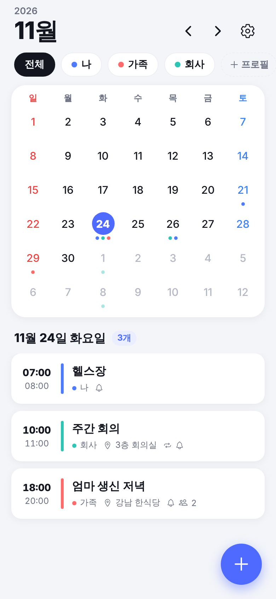
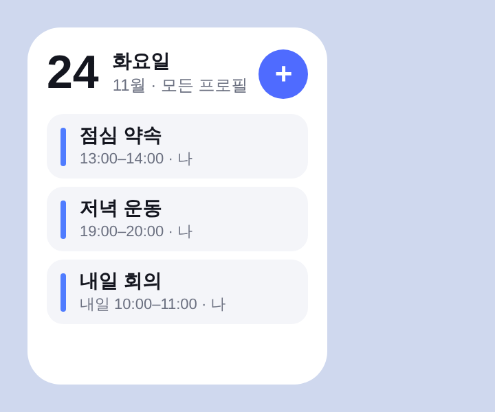
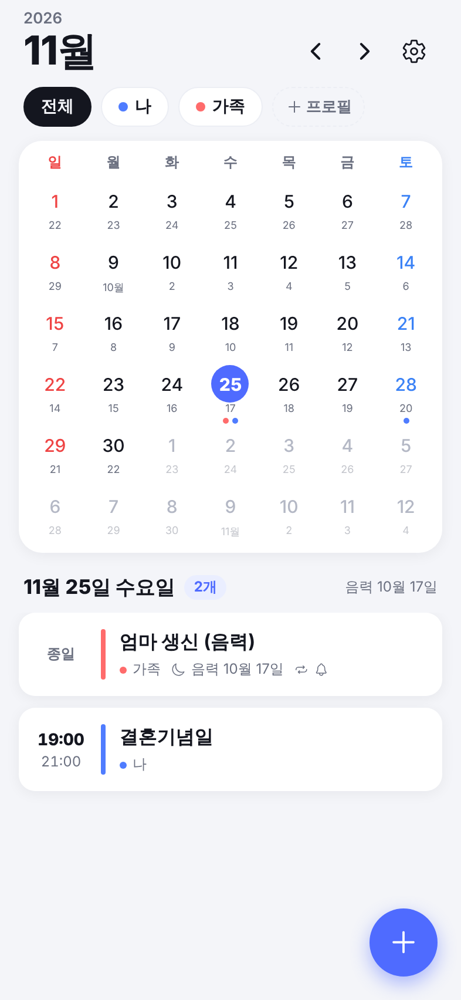
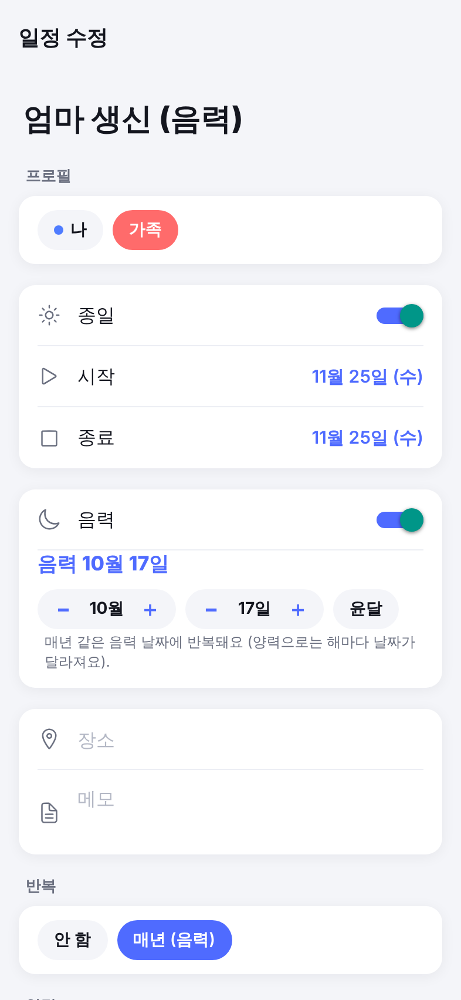

# 캘린더 (Expo / React Native)

타임트리·구글 캘린더를 참고한 일정 관리 앱.

## 화면
| 홈 (라이트) | 홈 (다크) | 일정 | 프로필 |
|---|---|---|---|
|  |  |  |  |

> 웹 렌더링(390×844)으로 캡처한 화면입니다. 다크 모드는 시스템 설정을 따라갑니다.

### 홈 위젯 (Android)
| 라이트 | 다크 | 작은 크기 |
|---|---|---|
|  |  |  |

> 위젯 트리를 HTML로 근사 렌더링한 미리보기라 실제 런처에서는 폰트/여백이 조금 다를 수 있어요. 일정 카드를 누르면 해당 일정이, `+`를 누르면 새 일정 화면이 열리고, 위젯 크기에 따라 보이는 일정 수가 달라져요.

### 음력
| 달력에 음력 표시 | 음력 반복 일정 |
|---|---|
|  |  |

## 기능
- **여러 프로필**: 프로필(나/가족/회사 …)별 색상·이름 관리. 홈 상단 칩으로 *프로필별 보기* 또는 *전체 보기* 전환, 전체 보기에 포함할 프로필은 개별 토글
- **음력**: 일정에 음력 날짜 지정, 매년 같은 음력 날짜에 반복(음력 생일·제사 등), 윤달 지원, 달력에 음력 표시 토글
- 월 달력 + 날짜별 일정 목록, 종일/기간/반복(매일·매주·매월·매년) 일정
- **알림**: 일정별 (정각/10분/30분/1시간/하루 전) 로컬 알림, 반복 일정 포함. 알림 탭 시 해당 일정으로 이동
- **홈 위젯 (Android)**: 선택한 프로필(또는 전체)의 오늘·내일 일정
- **구글 캘린더 연동**: OAuth(PKCE)로 로그인, 양방향 동기화(앱 ⇄ 기본 캘린더)
- **공유**: ① 일정에 이메일 추가 → 구글 캘린더 초대 발송 ② `.ics` 내보내기/가져오기(메신저·메일 공유 가능)

## 실행
```bash
npm install
npm test            # 핵심 로직 테스트
npm run typecheck
npx expo start      # Expo Go는 위젯/구글 로그인 제한 → 개발 빌드 권장
```
알림·위젯·구글 로그인은 네이티브 모듈이 필요하므로 개발 빌드로 실행하세요:
```bash
npx expo prebuild
npx expo run:android   # 또는 run:ios
```

## 구글 연동 설정
1. [Google Cloud Console](https://console.cloud.google.com)에서 프로젝트 생성 → **Google Calendar API** 사용 설정
2. OAuth 동의 화면(Google Auth Platform) 구성: 대상 *외부*, **테스트 사용자에 본인 구글 계정 추가**, 범위 `https://www.googleapis.com/auth/calendar.events` 추가
3. 사용자 인증 정보 → OAuth 클라이언트 ID 만들기 → 유형 **Android**
   - 패키지 이름: `com.hwetj.calendar`
   - SHA-1 인증서 지문: `5E:8F:16:06:2E:A3:CD:2C:4A:0D:54:78:76:BA:A6:F3:8C:AB:F6:25` (현재 APK 서명 키)
4. 발급된 클라이언트 ID(`xxxx.apps.googleusercontent.com`)를 앱에 주입
   - GitHub Actions 빌드: 저장소 Settings → Secrets and variables → Actions → **Variables** 에 `GOOGLE_CLIENT_ID_ANDROID` 로 추가
   - 로컬 빌드: `.env`의 `EXPO_PUBLIC_GOOGLE_CLIENT_ID_ANDROID`
5. APK를 다시 빌드해 설치 → 설정 → "구글 계정으로 연결"

> 동의 화면이 *테스트* 상태이면 로그인 유지(리프레시 토큰)가 약 7일이라 주기적으로 다시 연결해야 합니다.
> `calendar.events`는 민감 범위라 일반 공개하려면 구글 앱 인증이 필요합니다(개인 사용은 테스트 상태로 충분).

## 구조
- `src/lib` 도메인 로직(날짜·반복 전개·음력·프로필 필터·ICS·구글 API·알림·저장소) — `__tests__`에서 검증
- `src/app` Expo Router 화면 (홈, 일정 편집, 프로필, 설정)
- `src/widget` Android 홈 위젯 (`react-native-android-widget`)

## 알려진 한계 / 다음 단계
- iOS 홈 위젯 미구현 (`expo-widgets` 도입 예정)
- 앱 사용자끼리의 실시간 공유(자체 서버)는 미구현 — 현재는 구글 초대/.ics 방식
- 구글 동기화는 수동(설정 → 지금 동기화), 삭제 동기화는 앱에서 삭제 시에만 반영
- 시뮬레이터/실기기 UI 검증은 아직 못 했고, 타입체크·로직 테스트·Android 번들 빌드까지 확인함

## 음력 정확도 검증
`src/lib/lunar.ts`는 `korean-lunar-calendar`(한국천문연구원 기준 데이터)를 사용하고, `scripts/verify-lunar`의 **천문 계산(KST 삭 + 중기 + 무중월 윤달)** 과 1950-01-01~2050-12-31 **36,890일 전체**를 대조해 불일치 0건을 확인했습니다. 한국 음력은 한국 표준시 기준이라 중국 음력과 하루 다를 수 있습니다(예: 2028 설날은 한국 1/27, 중국 1/26).
